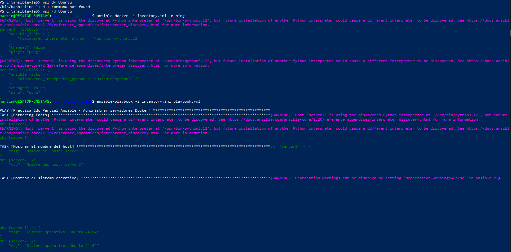

# Práctica 2do Parcial - Ansible

## Objetivo de la práctica

Crear un laboratorio con dos servidores Linux (Ubuntu 24.04) utilizando Docker y
administrarlos con Ansible mediante un inventario y un playbook que muestra
información del host, crea directorios y archivos, usa un `loop` y una
condición (`when`).

## Estructura del proyecto

```
ansible-lab/
├── docker-compose.yml
├── inventory.ini
├── playbook.yml
├── README.md
└── captura.png
```

## Requisitos

- Docker y Docker Compose
- Ansible (`pip install ansible` o `sudo apt install ansible`)
- En Windows, ejecutar Ansible desde WSL2 (Ubuntu) con Docker Desktop integrado

## Comandos para iniciar los contenedores

```bash
docker compose up -d
docker ps
```

Instalar Python en cada contenedor (requisito de Ansible):

```bash
docker exec server1 bash -c "apt update && apt install -y python3"
docker exec server2 bash -c "apt update && apt install -y python3"
```

Comprobar la conexión con el inventario:

```bash
ansible docker -i inventory.ini -m ping
```

## Comando para ejecutar el playbook

```bash
ansible-playbook -i inventory.ini playbook.yml
```

## Qué hace el playbook

En `server1` y `server2`:

1. Muestra el nombre del host.
2. Muestra el sistema operativo.
3. Crea el directorio `/tmp/ansible-demo`.
4. Crea el archivo `info.txt` con el nombre del servidor y el sistema operativo.
5. Crea con un `loop` los directorios `logs`, `backup` y `config`.
6. Muestra un mensaje solo cuando el sistema operativo es Ubuntu (`when`).

## Verificación opcional

```bash
docker exec server1 cat /tmp/ansible-demo/info.txt
docker exec server1 ls /tmp/ansible-demo
```

## Captura de la ejecución exitosa



## Detener el laboratorio

```bash
docker compose down
```
